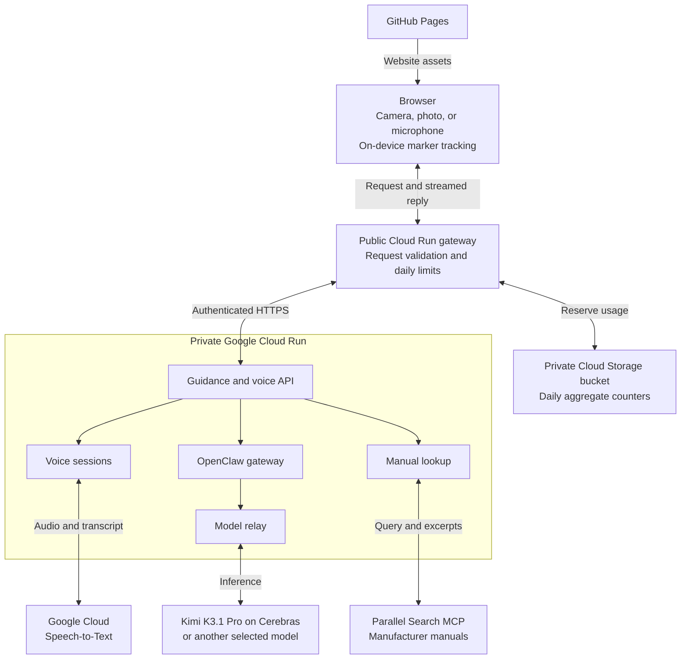

# Proxima AR

A visual guide to the hardware in front of you. Upload a photo or point your camera, ask a question, and Proxima answers. Kimi K3.1 Pro on Cerebras can highlight a visible part or consult the manufacturer’s documentation.

Open the live demo from the website link in this repository’s **About** section.

## System architecture

The camera opens in preview. Pressing **Speak** freezes one picture immediately, before microphone permission or transcription. Pressing **Ask** with a typed question (or submitting it with Enter) freezes one picture at submission. The white square in the upper left flashes red and reads **Frame captured**. Request activity records the action and local time. The token-speed timeline adds a red diamond for each capture. Repeating a question uses the original picture, and **Anchor map only** sends coordinates and labels.

For voice questions, the backend streams audio to Speech-to-Text. When the transcript is ready, the browser sends it with the picture from the initial tap. Cancelling before submission keeps that picture on the device. JSFeat reads small camera images locally while waiting for a target or following a marker. If the model requests a manual, the guidance API retrieves relevant passages and sends them through OpenClaw for a second answer.

## Public demo and usage limits

GitHub Pages serves the camera interface. The public Cloud Run gateway accepts three API paths and forwards validated questions and microphone audio to the private guide service. OpenClaw and its model relay listen on loopback inside that service. Its agent tools, browser control and shell commands are disabled. The public gateway authenticates with its attached Google service account and a shared token. Secret Manager supplies the project Cerebras key only to the private service.

Visitors share **25 questions and 300 seconds of voice per UTC day**. The gateway reserves a question before contacting the guide, so a provider failure can still use one question. Opening a microphone session reserves its first second. Additional audio is metered from the decoded 16 kHz mono PCM, rounded up to the next second per session. Repeated packets count once. Both limits apply when visitors bring their own provider key.

A private Cloud Storage object holds the two aggregate counters for each day. Conditional writes prevent overlapping requests or a restarted container from exceeding the allowance. If the counters are unavailable, the gateway declines the request. The quota object contains only aggregate usage. The browser keeps its session log in the open tab, and the hosting platforms maintain their own infrastructure access logs. Each Cloud Run service is configured for zero to one instance. These limits bound application use. Incoming HTTP traffic and other Google Cloud costs are still billable. [Google Cloud billing budgets](https://cloud.google.com/billing/docs/how-to/budgets)

### Deploy

1. Provision the private guide with `sh scripts/deploy-cloud.sh PROJECT_ID REGION`. The runtime account needs access to the two Proxima secrets and `roles/speech.client` for Google Cloud Speech-to-Text V2. The build account needs Cloud Run Builder permissions.
2. Run `sh scripts/deploy-public.sh PROJECT_ID REGION PAGES_HTTPS_ORIGIN` with the HTTPS origin of the GitHub Pages site, without its project path. This provisions a dedicated gateway identity, a private quota bucket and the gateway container. Give anonymous invoker access to **proxima-public** after verifying its quotas. Keep **proxima-guide** IAM-protected.
3. In the repository settings, choose GitHub Actions as the Pages source and set the Actions variable `PROXIMA_PUBLIC_API_ORIGIN` to the HTTPS origin of **proxima-public**. Run the **Publish GitHub Pages** workflow. Its artifact contains only browser assets and the public gateway address.
4. Run `npm test` for the quota, voice, vision and access checks. To build the same Pages artifact locally, set `PROXIMA_PUBLIC_API_ORIGIN` and run `npm run build`. The private and public container sources live in `server/` and `gateway/`.

## Model comparison

**Model settings** offers Cerebras, OpenAI, OpenRouter and Google Gemini. Choose a listed model or enter a model ID. Cerebras can use the project key. Personal provider keys are held in tab memory and sent to the private backend over HTTPS with the request. The relay sends the selected key only to the selected provider. Keys are excluded from OpenClaw inputs, activity logs and browser storage.

**Request activity** follows the frame through OpenClaw, any manufacturer lookup, provider attempts and completion. Cerebras fallback is enabled by default and can be switched off in Model settings. After a Kimi availability failure, the relay prefers GPT-OSS 120B on the same key. For a photo it asks an available vision model (preferably Qwen 3.8 27B) for observations, then GPT-OSS answers from text. Each question reuses its description during a manual lookup. If the frame cannot be described, the answer is marked as text-only. Anchor-map questions go straight to the answering model. The log names each model and shows its token rate. The effective rate beside the elapsed timer updates as model calls finish. Disabling fallback keeps retries on the selected model. **Run same frame again** reuses the captured pixels, question and original context with the newly selected model. A response includes the actual provider, model and token metrics. Effective output tok/s divides reported output tokens by the combined elapsed time of successful provider calls. Decode tok/s uses provider-reported generation time when available. Time to answer also includes upload, OpenClaw, lookup, retries and rendering. Missing usage is displayed as unavailable.

**Token speed** charts output tokens per second against elapsed time from the first camera or photo in this tab. Each completed provider call contributes a measurement. Effective speed includes provider wait, and Decode uses provider-reported generation time. The session maximum identifies the fastest measured call for each mode and persists through idle time and follow-up questions. Missing timings leave gaps. The latest request breakdown shows effective and decode rates, output tokens, provider and generation times, and the number of completed calls.

## Ask about a device

1. In **Visual guide**, choose **Upload photo** or **Use camera**. Tap **Speak** and ask a question, or type it and press **Ask**. You can also try the sample Raspberry Pi photo.
2. Kimi answers from the frame when it can. If it needs the device’s documentation, it identifies the manufacturer, device and topic and asks the companion to look them up. Proxima shows the search in progress, sends the relevant passages back through OpenClaw, and links the documents alongside the answer. If the image does not identify a necessary model number, Kimi can ask for it. An unsuccessful search is shown in the answer.
3. Ask follow-ups in the same scene. The companion keeps retrieved passages in memory for up to an hour and the browser includes the three most recent exchanges. Replacing the scene starts a fresh conversation. **Session log** keeps the answers, sources and measured response times for the open browser tab.

To see a part, ask “Can you mark the ampersand key?” in **Visual guide**. Proxima draws a red ring on the photo or tracks it on the camera. For small printed controls, the cloud service enlarges visible legends and asks the vision model to select and confirm one. Each selection maps to pixels in the captured frame. When the part leaves view, the marked camera frame appears below the video. Bring the part back into view and the live ring returns once the browser recognizes it. An unresolved request shows a prompt to move closer.

**Set your own anchors** opens the same scene. Tap a part to name or reposition it, or attach a text-based PDF, TXT or Markdown file under **Field manual**. **Anchor map only** lets Kimi answer from named points without a photo upload. The sample board’s four hand-mapped markers are available in this view.

During microphone setup and transcription, **Cancel** returns you to the question box. While listening, a pause or **Finish** submits your question, and **Cancel** discards it. While an answer is pending, **Speak again** starts a new voice question and **Cancel answer** stops waiting for the current one. Each recording lasts up to 45 seconds. The browser sends ordered packets of 16 kHz mono audio and keeps audio in memory only.

## Camera tracking and document lookup

The snapshot and tracking baseline use the same pixels. Forward–backward optical flow checks reject inconsistent tracks. A local similarity transform maps the original point to the current frame, and a changed scene invalidates outstanding replies. Tracking is two-dimensional and targets up to 30 updates per second. When a target disappears, the browser searches returning frames using multi-scale ORB feature matches and compares the target and its surroundings against the question frame. A second live frame confirms a match before the ring reappears. This runs on the device between questions. Stopping the camera clears its tracking data.

The same `/api/guide` contract accepts an unlabeled image from web or future native clients. Clients can pass back a `contextId` with a follow-up. The companion uses Parallel’s Search MCP to search and read manufacturer pages or PDFs using product and procedure terms. Camera frames go through OpenClaw to the selected provider. The public status endpoint reports on-demand availability without waking OpenClaw. An accepted question starts the private service when needed.

Documentation lookups are limited to a maintained manufacturer list, bounded product-model terms and predefined procedure topics. The backend supplies all lookup destinations. Text found inside a photo or manual can still mislead the model’s answer.

Relevant upstream interfaces are documented by [OpenClaw](https://docs.openclaw.ai/gateway/openresponses-http-api), [Cerebras](https://inference-docs.cerebras.ai/api-reference/chat-completions), [JSFeat](https://inspirit.github.io/jsfeat/) and [PDF.js](https://mozilla.github.io/pdf.js/). The reference image is [Jainath Ponnala’s Raspberry Pi photograph](https://unsplash.com/photos/a-close-up-of-a-raspberry-board-on-a-table-BIHgNEaM394). Its credit and the bundled library licenses are included in `web/`.
