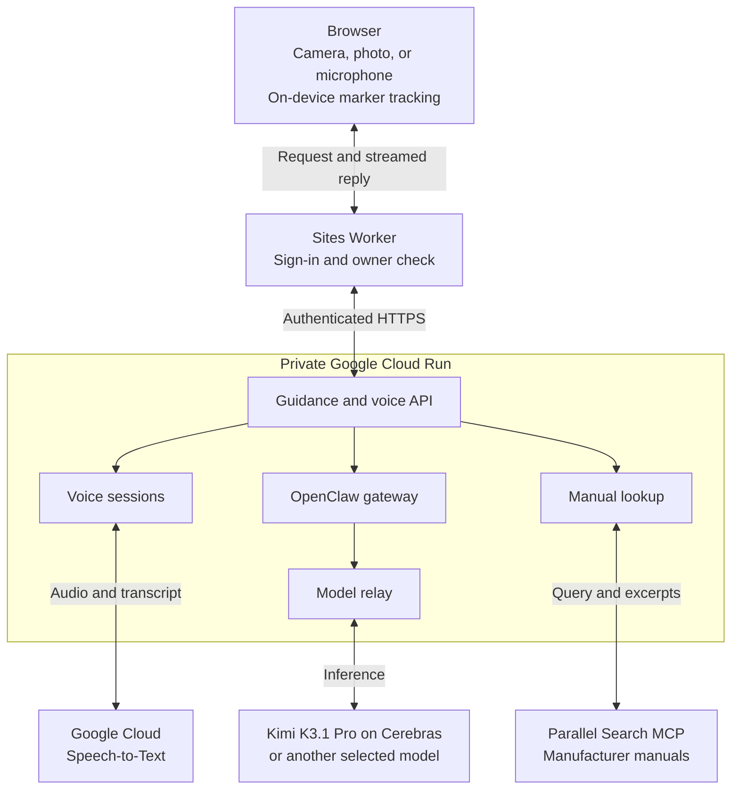

# Proxima AR

A visual guide to the hardware in front of you. Upload a photo or point your camera, ask a question, and Proxima answers. Kimi K3.1 Pro on Cerebras can highlight a visible part or consult the manufacturer’s documentation.

## System architecture

The browser captures a frame when you ask a question. It uses JSFeat to track a returned marker as the camera moves. For a spoken question, the backend streams audio to Speech-to-Text, and the browser submits the finished transcript with the saved frame. If the model requests a manual, the guidance API retrieves relevant passages and sends them through OpenClaw for a second answer.

## Private hosting

The private website serves the camera UI and its API on one HTTPS origin. Sites handles sign-in and the owner-only access list. The Worker also checks the signed-in visitor against `PROXIMA_OWNER_EMAIL` on every route. A holder of a Site service token still needs a signed-in owner identity to open Proxima or ask a question.

The live-guidance backend runs in a private Google Cloud Run container. It accepts `/api/status`, `/api/voice` and `/api/guide` from the authenticated Site. OpenClaw listens on loopback inside the container. The gateway has a fresh private workspace under the container’s temporary directory, a read-only configuration, a loopback model relay, and disabled agent tools, browser control, chat commands, and scheduled tasks. The Node process runs as the container’s unprivileged `node` user. A camera stream stays in the browser between questions.

The Worker needs the service’s HTTPS URL, an invocation-only Google service account credential and a separate service token. The container reads `CEREBRAS_API_KEY` and the matching `PROXIMA_SERVICE_TOKEN` from its cloud secret bindings. When the backend is unconfigured, the UI still opens and live answers show as offline. The application has no laptop fallback.

Use `npm test` for the access, model contract and geometry checks and `npm run build` for the standalone Sites Worker. Frontend source lives in `web/`. The Dockerfile and cloud upload allowlists include the Node backend and its text-excerpt helper. Local credentials, prior runtime data and the frontend source bundle are excluded from the container build context.

### Connect a Cloud Run service

Voice input uses the Google Cloud Speech-to-Text V2 API (`speech.googleapis.com`). Enable it in the Cloud Run project and grant `roles/speech.client` to the runtime service account. The Google client uses that attached identity. The open microphone session and its ordered audio uploads share the existing single-instance Cloud Run service.

In the chosen Google Cloud project, use dedicated `proxima-runtime`, `proxima-build`, and `proxima-invoker` service accounts. Give the runtime account Secret Manager accessor permission on `proxima-cerebras` and `proxima-service-token` only. The build account needs Cloud Run Builder permissions. Run `sh scripts/deploy-cloud.sh PROJECT_ID REGION` from the checkout. It enables Cloud Run’s invoker check, disables anonymous access and scales between zero and one instance. Grant the invoker account `roles/run.invoker` on `proxima-guide` only.

Set `PROXIMA_SERVICE_URL` to the canonical `run.app` service origin in Sites. Store the invoker’s JSON credential under `PROXIMA_CLOUD_INVOKER` and the shared random service token under `PROXIMA_SERVICE_TOKEN` as Site secrets. The edge service exchanges a signed assertion for a short-lived Google ID token. Publish the Site with the new variables and check the signed-in **Runtime connection** panel. The default Cerebras project key belongs in the backend secret. [Cloud Run service authentication](https://docs.cloud.google.com/run/docs/authenticating/service-to-service)

## Model comparison

**Model settings** offers Cerebras, OpenAI, OpenRouter and Google Gemini. Choose a listed model or enter a model ID. Cerebras can use the project key. Personal provider keys are held in tab memory and sent to the private backend over HTTPS with the request. The relay sends the selected key only to the selected provider. Keys are excluded from OpenClaw inputs, activity logs and browser storage.

**Request activity** follows the frame through OpenClaw, any manufacturer lookup, provider attempts and completion. Cerebras fallback is enabled by default and can be switched off in Model settings. After a Kimi availability failure, the relay prefers GPT-OSS 120B on the same key. For a photo it asks an available vision model (preferably Qwen 3.8 27B) for observations, then GPT-OSS answers from text. Each question reuses its description during a manual lookup. If the frame cannot be described, the answer is marked as text-only. Anchor-map questions go straight to the answering model. The log names each model and shows its token rate. The effective rate beside the elapsed timer updates as model calls finish. Disabling fallback keeps retries on the selected model. **Run same frame again** reuses the captured pixels, question and original context with the newly selected model. A response includes the actual provider, model and token metrics. Effective output tok/s divides reported output tokens by the combined elapsed time of successful provider calls. Decode tok/s uses provider-reported generation time when available. Time to answer also includes upload, OpenClaw, lookup, retries and rendering. Missing usage is displayed as unavailable.

**Token speed** charts output tokens per second against elapsed time from the first camera or photo in this tab. Each completed provider call contributes a measurement. Effective speed includes provider wait, and Decode uses provider-reported generation time. The session maximum identifies the fastest measured call for each mode and persists through idle time and follow-up questions. Missing timings leave gaps. The latest request breakdown shows effective and decode rates, output tokens, provider and generation times, and the number of completed calls.

## Ask about a device

1. In **Visual guide**, choose **Upload photo** or **Use camera**. Tap **Speak** and ask a question, or type it and press **Ask**. You can also try the sample Raspberry Pi photo.
2. Kimi answers from the frame when it can. If it needs the device’s documentation, it identifies the manufacturer, device and topic and asks the companion to look them up. Proxima shows the search in progress, sends the relevant passages back through OpenClaw, and links the documents alongside the answer. If the image does not identify a necessary model number, Kimi can ask for it. An unsuccessful search is shown in the answer.
3. Ask follow-ups in the same scene. The companion keeps retrieved passages in memory for up to an hour and the browser includes the three most recent exchanges. Replacing the scene starts a fresh conversation. **Session log** keeps the answers, sources and measured response times for the open browser tab.

To see a part, ask “Can you mark the ampersand key?” in **Visual guide**. Proxima draws a red ring on the photo or tracks it on the camera. For small printed controls, the cloud service enlarges visible legends and asks the vision model to select and confirm one. Each selection maps to pixels in the captured frame. When the part leaves view, the marked camera frame appears below the video. Bring the part back into view and the live ring returns once the browser recognizes it. An unresolved request shows a prompt to move closer.

**Set your own anchors** opens the same scene. Tap a part to name or reposition it, or attach a text-based PDF, TXT or Markdown file under **Field manual**. **Anchor map only** lets Kimi answer from named points without a photo upload. The sample board’s four hand-mapped markers are available in this view.

**Speak** saves the current frame or anchor map in the browser. As you talk, the browser sends short, ordered packets of 16 kHz mono audio to the private service. Google Speech-to-Text streams the transcript back into the question box. A pause or **Finish** closes the audio stream. Proxima sends the confirmed question through OpenClaw with that saved frame, conversation history and relevant manual passages. **Cancel** discards the turn. Each recording lasts up to 45 seconds, and the app keeps audio in memory only.

## Camera tracking and document lookup

The snapshot and tracking baseline use the same pixels. Forward–backward optical flow checks reject inconsistent tracks. A local similarity transform maps the original point to the current frame, and a changed scene invalidates outstanding replies. Tracking is two-dimensional and targets up to 30 updates per second. When a target disappears, the browser searches returning frames using multi-scale ORB feature matches and compares the target and its surroundings against the question frame. A second live frame confirms a match before the ring reappears. This runs on the device between questions. Stopping the camera clears its tracking data.

The same `/api/guide` contract accepts an unlabeled image from web or future native clients. Clients can pass back a `contextId` with a follow-up. The companion uses Parallel’s Search MCP to search and read manufacturer pages or PDFs using product and procedure terms. Camera frames go through OpenClaw to the selected provider. Poll `/api/status` for the installed OpenClaw version and gateway readiness.

Documentation lookups are limited to a maintained manufacturer list, bounded product-model terms and predefined procedure topics. The backend supplies all lookup destinations. Text found inside a photo or manual can still mislead the model’s answer.

Relevant upstream interfaces are documented by [OpenClaw](https://docs.openclaw.ai/gateway/openresponses-http-api), [Cerebras](https://inference-docs.cerebras.ai/api-reference/chat-completions), [JSFeat](https://inspirit.github.io/jsfeat/) and [PDF.js](https://mozilla.github.io/pdf.js/). The reference image is [Jainath Ponnala’s Raspberry Pi photograph](https://unsplash.com/photos/a-close-up-of-a-raspberry-board-on-a-table-BIHgNEaM394). Its credit and the bundled library licenses are included in `web/`.
